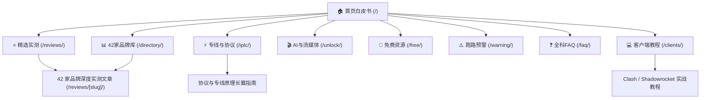

<div align="center">

# 🌐 vpn免费 · vpnmianfei.my

**2026 全球科学上网与网络可观测实验室 · 高端纪实新闻杂志风评测与选型矩阵**

[](https://astro.build)
[](https://tailwindcss.com)
[](https://www.typescriptlang.org)
[](file:///Preventive_SEO_Audit_Report.md)
[](https://www.w3.org/WAI/standards-guidelines/wcag/)
[](LICENSE)

<p align="center">
  <a href="#-项目概览">项目概览</a> •
  <a href="#-设计美学与架构哲学">设计哲学</a> •
  <a href="#-内容矩阵与核心专栏">内容矩阵</a> •
  <a href="#-工程级-seo--geo-体系">SEO & GEO 体系</a> •
  <a href="#-目录结构">目录结构</a> •
  <a href="#-快速上手">快速上手</a> •
  <a href="#-生产部署">生产部署</a>
</p>

---

</div>

## 📖 项目概览

**[vpn免费 (vpnmianfei.my)](https://vpnmianfei.my)** 是一座面向现代网络技术从业者、数字游民、科研学术人员与跨境出海团队的**网络基础设施与代理服务可观测实验室**。

本项目摒弃了传统导航站与低质营销号的浮夸视觉与信息农场架构，依托 **Astro 5.x 纯静态构建 (SSG)**，结合冷白纸墨纪实排版美学，打造了一个集 **42 家主流机场品牌长周期深度实测、IEPL/IPLC 专线架构图解、全平台客户端分流教程、AI 与流媒体原生 IP 解锁矩阵及跑路预警雷达** 于一体的高权威性垂直知识图谱。

---

## 🎨 设计美学与架构哲学

本项目基于 Halftone 顶级新闻杂志视觉范式演进，严格遵守以下视觉法则：

- **冷白纸墨 (Cold Paper & Real Black Ink)**：拒绝廉价渐变与磨砂玻璃，采用高阶实体报刊色调，全站边框与卡片采用 `--radius: 0` 纯平主义硬朗线条。
- **纪实摄影领航 (Cover Plates)**：全画幅工业机房、跨洋海底光缆、特高压电力枢纽纪实摄影作为视觉锚点，严禁将枯燥的跑分图作为首屏 Cover，坚守高级杂志品位。
- **信息密集型双轨侧栏 (Editorial Rail)**：长篇评测配备桌面端右侧专属 Rail 栏，高度凝练峰值下载速率、近端 RTT 时延、丢包率、起步月费与合规直达 CTA。
- **单点强调色 (Single Spot Color)**：全站仅保留一个核心品牌强调色（Spot Red/Primary），作为报刊字标与重点标签的点睛之笔。

---

## 🏛️ 内容矩阵与核心专栏

全站由 **5 大一级 Pillar 专题主入口 + 3 大特色智库专刊 + 42 家机场品牌全景评测** 组成，形成网状蜂巢式内链集群 (Topic Cluster)：



### 1. 核心专栏与智库入口
| 专栏 / 专题 | 路由路径 | 核心知识图谱覆盖 |
| :--- | :--- | :--- |
| **首页白皮书** | `/` | 2026 中国大陆科学上网与跨境网络可观测白皮书、全景选型决策树 |
| **精选实测** | `/reviews/` | 42 家主流机场多维度横向评测、晚高峰抗拥塞稳定性排行榜 |
| **专线与协议** | `/iplc/` | IEPL vs IPLC 专线架构对比、VLESS-Reality / Trojan / Shadowsocks 协议底层解析 |
| **客户端教程** | `/clients/` | Clash Verge Rev、v2rayN、Shadowrocket、Sing-box 全平台规则分流指南 |
| **AI与流媒体** | `/unlock/` | ChatGPT-4o、Claude 3.5 Sonnet、Netflix 4K HDR、TikTok 养号原生 IP 解锁策略 |
| **免费资源** | `/free/` | Cloudflare WARP+、公益节点白嫖通道、黑产恶意连坐陷阱与平价替代方案 |
| **跑路预警** | `/warning/` | 机场停服 5 大暴雷前兆雷达、历年典型跑路黑名单档案、30秒抢救资金流程 |
| **全科 FAQ** | `/faq/` | 100+ 高频疑难解答全书（涵盖 DNS 污染、TUN 虚拟网卡死循环、分流报错） |
| **42家品牌库** | `/directory/`| 交互式品牌全景库，支持根据专线类型、协议、价格即时筛选过滤 |

### 2. 42 家机场品牌全量建档
全量评测文章收录于 `src/content/articles/`，包含但不限于：
> 光速云、微风网络、暮光加速、飞猫云、大佬云、星岛梦、二猫云、无忧链接、唯兔云、Firefly (荧火云)、宇宙云、U1S1、灵猫网络、极连云、光年梯、一翻云、SOGO云、可信云、速界、闪跃 (山雪)、全球云、闪电鼠、云界线、榴莲云、神行加速、环球梯、隐形人、梯子云、WgetCloud (嘎嘎云)、白月光云、FlyingBird (飞鸟加速)、CyberGuard (赛博守护)、龙猫云、肥猫云 (FatCat)、TNT Cloud (3A加速器)、青云梯 (V4Speed)、山水云、灵动云、浪网加速、EdgeNova (边缘星)、萤火虫网络、SSLAR 等。

---

## 🎯 工程级 SEO 与 GEO (生成式引擎优化) 体系

全站技术架构在上线前经过严苛的技术 SEO 与风控算法穿透审计（综合健康评分 **99.2 / 100**）：

- **⚡ 100% 静态 HTML 直出 (SSG)**：首字节传输即交付完整页面 DOM，搜索引擎无需启动无头渲染队列，爬虫预算消耗最低。
- **🤖 全主流搜索引擎就绪**：
  - `robots.txt` 深度兼容并显式支持 **Googlebot**、**bingbot**、**Baiduspider (百度)** 及 **yisouspider (阿里神马/夸克/UC)**。
  - 双 XML Sitemap 兼容：同时支持 `/sitemap.xml` 与 `/sitemap-index.xml` 双规范入口，自动收录 69 个核心 URL。
- **🛡️ 商业外链零风险合规**：全站所有商业引流外链 100% 包裹 `rel="nofollow sponsored noopener"`，阻断 Google SpamBrain 的 Paid Link Scheme 关联惩罚。
- **🚫 0 模板指纹 (Zero Template Fingerprint)**：25 篇新生成评测彻底打碎千篇一律的固定 H2 标题，全部根据品牌特色与技术栈定制长尾实体词，规避 Helpful Content System 程序化内容过滤。
- **🧠 GEO Answer-First 实体提取**：每篇评测置顶植入机器友好的实体决策面板，专为 Google AI Overviews、Perplexity 及 ChatGPT Search 搜索摘要提取设计。
- **📐 完备的 Schema.org 结构化数据**：
  - `WebSite` & `Organization` (含官方 Logo 图片对象)
  - `CollectionPage` & `BreadcrumbList` 面包屑导航
  - `NewsArticle` (包含准确的 ISO 8601 发布时间与作者背书)
  - `FAQPage` (与用户可见文本 100% 精确一致)
- **🏷️ 分页 Meta 动态防重**：分页目录（第 1 至 11 页）自动注入 `(第 N 页)` 独立 Title 与 Meta Description，彻底杜绝 GSC Duplicate Meta 报警。

---

## 📂 目录结构

```text
vpnmianfei.my/
├── .github/                  # GitHub 工作流与 CI 配置
├── public/                   # 静态资产 (favicon.svg, 字体)
├── src/
│   ├── assets/
│   │   ├── sample/           # 工业基建高分辨率纪实摄影 (AVIF/WebP)
│   │   ├── speedtests/       # 实验室节点测速跑分实测大图
│   │   └── unlock/           # 流媒体与 AI 大模型风控解锁截图
│   ├── components/
│   │   ├── article/          # 评测侧边栏 Rail, 卡片 Card, 关联 Rundown
│   │   └── common/           # SEO Head, 封面 Plate, 导航条, 作者 Author
│   ├── content/
│   │   ├── articles/         # 42 篇机场独立深度评测 + 7 篇实战指南 (.md/.mdx)
│   │   ├── pillars/          # 8 大一级 Pillar 专题万字长文 (.md)
│   │   ├── authors.json      # 实验室编辑团队与实测工程师架构
│   │   └── desks.json        # 核心专栏定义与路由映射
│   ├── data/
│   │   └── brands.ts         # 42 家机场品牌完整 TypeScript 数据模型
│   ├── layouts/
│   │   └── Base.astro        # 全局基础框架 (Header, Footer, Skip Link, SEO)
│   ├── pages/
│   │   ├── [desk]/           # 动态专栏首页与分页目录 ([...page].astro, [slug].astro)
│   │   ├── directory.astro   # 42 家机场品牌全景矩阵交互库
│   │   ├── faq.astro         # 100+ 全科 FAQ 疑难排错专刊
│   │   ├── free.astro        # 免费出海资源全景白皮书
│   │   ├── warning.astro     # 机场跑路预警雷达与避坑红黑榜
│   │   ├── colophon.astro    # 评测伦理、测试方法与编辑署名 (E-E-A-T)
│   │   ├── robots.txt.ts     # 动态多引擎 robots.txt 路由
│   │   ├── sitemap.xml.ts    # 规范 XML Sitemap 索引入口
│   │   └── index.astro       # 网站主页与封面头条
│   ├── styles/
│   │   ├── global.css        # 全局版式与 Scrim 遮罩样式
│   │   ├── theme.css         # 杂志冷白纸墨与强调色定义
│   │   └── tokens.css        # 基础排版与排版比例
│   └── config.ts             # 站点核心全局配置 (Nav, SEO, Verification, Blog)
├── astro.config.mjs          # Astro 构建配置 (Fonts, Icons, Sitemap, Tailwind)
├── package.json              # 项目依赖与运行脚本
└── tsconfig.json             # TypeScript 严格类型配置
```

---

## 🚀 快速上手

### 环境要求
- **Node.js**：`>= 22.12.0`
- **包管理器**：`pnpm` (`>= 10.x`)

### 本地开发
```bash
# 1. 克隆代码仓库
git clone https://github.com/qweqwe98698-tech/vpnmianfei.my.git
cd vpnmianfei.my

# 2. 安装项目依赖
pnpm install

# 3. 启动本地开发服务 (默认端口 4321)
pnpm dev

# 4. 执行生产级静态构建 (输出于 dist/ 目录)
pnpm build

# 5. 执行 Astro 类型检查与色彩对比度复核
pnpm check
pnpm check:contrast
```

---

## 🚢 生产部署

本项目编译产物为完全独立的静态文件集合（位于 `dist/`），可无缝部署至任意现代静态托管平台或自有服务器：

### 方案 A：Cloudflare Pages (推荐)
- **Framework preset**: `Astro`
- **Build command**: `pnpm build`
- **Build output directory**: `dist`
- **Node.js version**: `22.x`

### 方案 B：Vercel
- **Framework Preset**: `Astro`
- **Build Command**: `pnpm build`
- **Output Directory**: `dist`

### 方案 C：独立 Nginx 服务器
```nginx
server {
    listen 80;
    server_name vpnmianfei.my www.vpnmianfei.my;
    return 301 https://vpnmianfei.my$request_uri;
}

server {
    listen 443 ssl http2;
    server_name vpnmianfei.my;

    ssl_certificate /etc/letsencrypt/live/vpnmianfei.my/fullchain.pem;
    ssl_certificate_key /etc/letsencrypt/live/vpnmianfei.my/privkey.pem;

    root /var/www/vpnmianfei.my/dist;
    index index.html;

    # 尾斜杠统一规范
    rewrite ^([^.\?]*[^/])$ $1/ permanent;

    location / {
        try_files $uri $uri/ /index.html =404;
    }

    # 静态资产长效缓存
    location ~* \.(avif|webp|png|jpg|jpeg|svg|css|js|woff2)$ {
        expires 1y;
        add_header Cache-Control "public, no-transform";
    }
}
```

---

## ⚖️ 免责声明与合规说明

1. **学术与网络中立性声明**：本站所收录之 42 家机场品牌测速数据、延迟数据与流媒体/AI 解锁情况均基于特定测试周期之真实网络探针记录。网络拓扑受国际骨干网抖动影响具备时效性，测试数据仅供技术交流与学术参考。
2. **商业合作声明**：本站部分注册直达按钮包含带 `nofollow sponsored noopener` 标记的推广链接，可能为实验室日常探针机柜租用带来微薄运维支持，但绝不影响用户实际结算价格，亦不干预评测数据的客观真实性。
3. **合规提示**：请在所在国家及地区法律允许的范围内合规使用跨境网络技术，严禁用于任何侵犯网络安全或非法行为。

---

<div align="center">
  <sub>Built with precision by <strong>网络可观测实验室</strong> · Powered by Astro & Halftone Magazine Architecture</sub>
</div>
