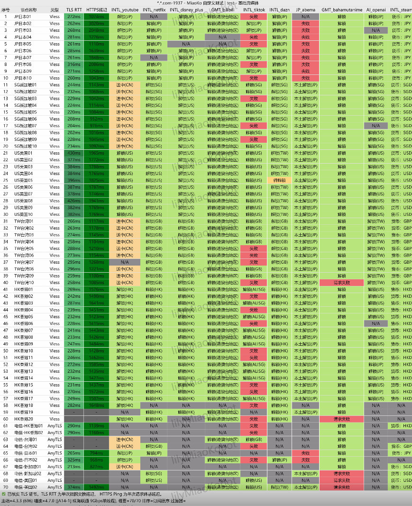

## AI 平台为什么封禁代理节点？

*图：网络可观测实验室对各区域落地原生 IP 对主流大语言模型的实时解锁检测数据面板*

OpenAI、Anthropic 等头部大模型厂商采用了业内最严厉的云盾反爬虫系统（主要是 Cloudflare Enterprise 与自身自建的威胁情报库）：

1. **IP 归属属性扫描**：如果节点 IP 被标记为 `Hosting / DataCenter`（机房机架主机），风控级别会立刻提高；
2. **连接密度检测**：如果成千上万个公网用户通过同一个出口 IP 频繁并发请求 API，极易被识别为恶意爬虫池整体封禁；
3. **DNS 与地理位置不一致**：本地 DNS 解析与实际出口发生地域割裂，也会触发会话阻断。

---

## 3 条黄金选型准则

1. **优选原生 ISP 住宅段**：选择如**光速云**、**极连云**这类提供明确标明原生（Residential / Native IP）的专用节点；
2. **避开热门大机房香港广播段**：部分劣质中转机场用广播 IP 伪装香港，实则机房位于敏感地区，极易被 OpenAI 判定为欺诈；
3. **优先选定新加坡、美西原生节点**：新加坡节点与美西原生节点的连通容忍度在实测中表现最宽容。
