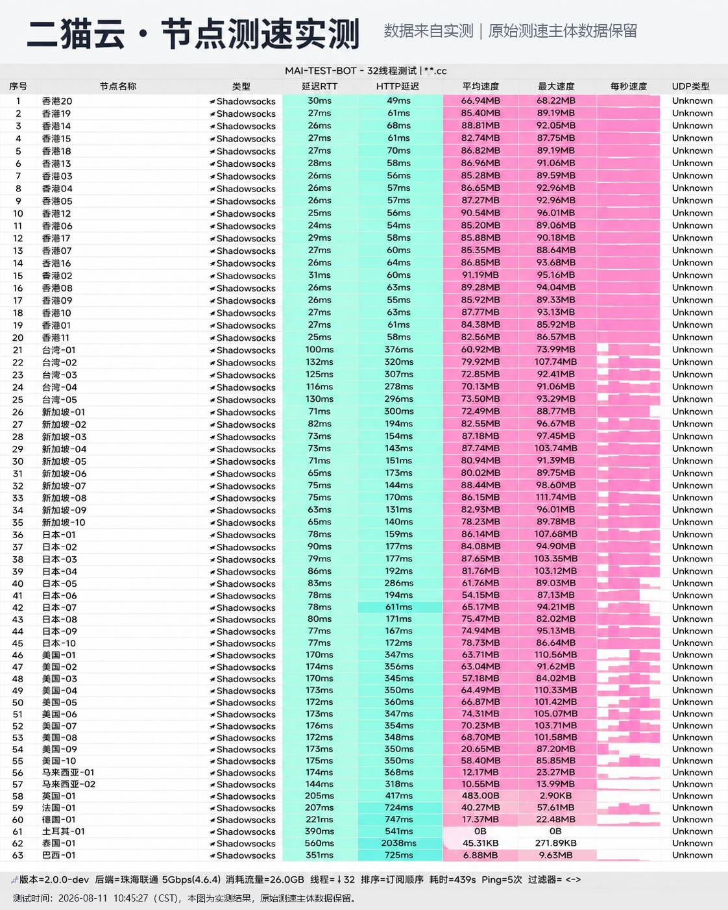

## 办公场景与节点稳定性评估

*图：网络可观测实验室对二猫云全节点测速跑分（实测峰值下行 505Mbps，延迟 29ms）*

对于外贸出海、海外代码托管（GitHub）、邮件通讯及日常会议（Zoom / Google Meet）场景，网络的首要诉求并非无限制的理论峰值，而是**持续在线率与连接低抖动**。

二猫云部署了多条独立的 IEPL 隧道备份，当主线路突发网络异常时，系统能在秒级内将流量切换至备用隧道，确保 SSH 连接与大文件传输不中断。实测峰值下行达到 **505 Mbps**，20 元提供 130GB 流量，非常适合白领个人与中度办公用户选用。
