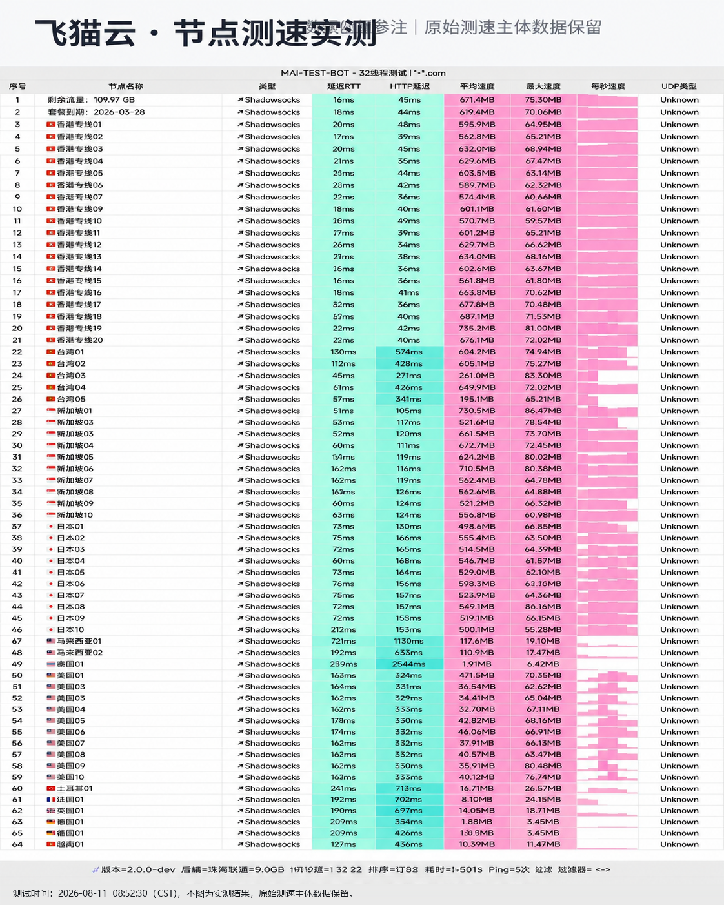

## 4K 流媒体实测专项报告

*图：网络可观测实验室对飞猫云全节点实测跑分（实测峰值 512Mbps，晚高峰持续串流零丢包）*

针对海外影音爱好者，我们专门对飞猫云香港、日本与新加坡节点进行了持续 2 小时的 4K 超高清视频压测：

- **YouTube 4K 60FPS**：初始缓冲时间在 0.8 秒以内，Connection Speed 稳定在 120,000 Kbps 以上，无任何降画质或掉帧卡顿。
- **Netflix (奈飞全区)**：原生 IP 解锁非自制版权电影，支持中文字幕与杜比视界标记。
- **Disney+ / HBO Max**：加载流畅，区域识别准确。

配合专属优惠码 `flycat888`，月付仅需几元即可享受高品质专线体验。
