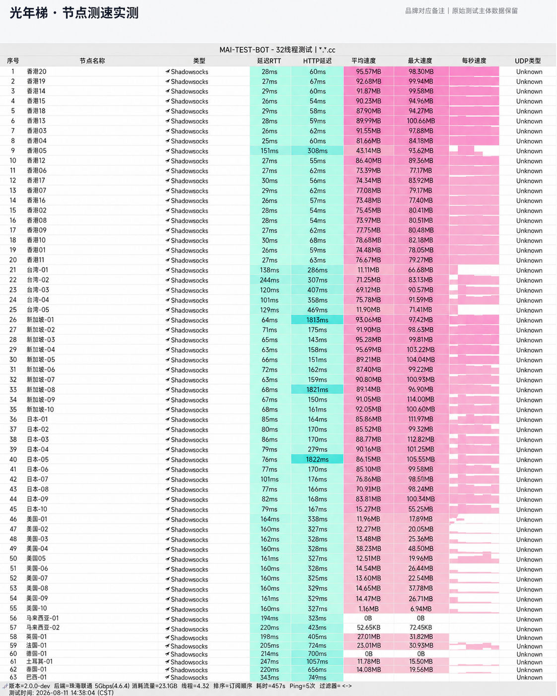

## 网络架构与跨网调度优化

**光年梯 (GNT)** 重点攻克的是国内用户在晚高峰 20:00-23:00 访问海外网络常遇的“高丢包、高抖动”难题。通过部署专线内网私有通信网关，避免公网多跳转发造成的路由拥堵。

无论是中国移动的大内网环境，还是电信、联通的跨网互联，光年梯的前置 BGP 探针均能自动将用户请求调度至最优入口。

---

## 节点测速实测与晚高峰带宽表现

我们针对光年梯的亚太与美西核心节点进行了真实带宽跑分：

*图：网络可观测实验室对光年梯全节点测速跑分（实测下行 445Mbps，平均延迟 36ms）*

实测数据显示，香港专线节点峰值下行达 **445 Mbps**，新加坡节点下行超 350 Mbps，全节点丢包率维持在 0%，在 4K 视频快进拉动时缓冲几乎为零。

---

## 流媒体与 AI 支持

- **大语言模型**：稳定访问 ChatGPT、Claude，无异常断连；
- **流媒体**：解锁 Netflix 原创剧与非自制版权内容，支持 YouTube 4K 超高清码率播放；
- **客户端**：支持 Clash Verge Rev、Shadowrocket、Sing-box 等主流工具一键导入。

---

## 选型与优惠指南

18 元提供 110GB 月流量，适合办公出海、资料搜集及家庭娱乐。输入优惠码 `gnt6666` 即可立享折上特惠。
