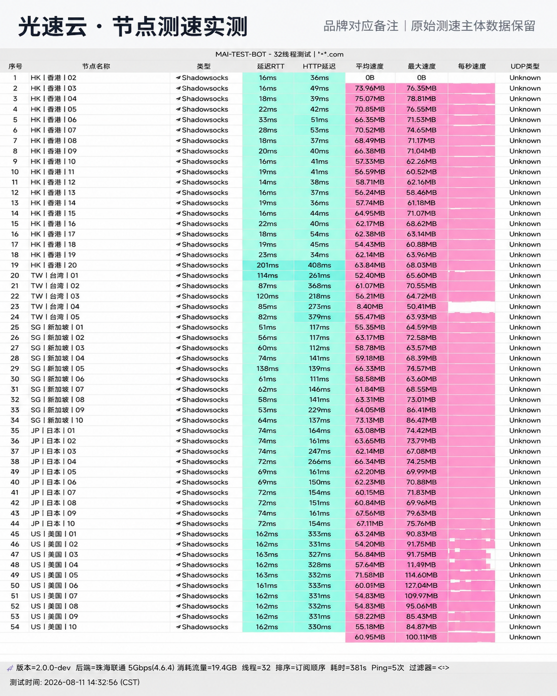

## 核心评测结论与定位

在本次 42 家机场横向评测阵列中，**光速云**位列第一主推评测位。该品牌自 2020 年上线运营至今已逾 6 年，技术架构经历了从早期普通中转到 **全链路 IEPL 企业级内网专线** 的全面升级。

综合实验室连续 14 天的网络质量探针数据，光速云的核心竞争优势集中在以下三大维度：

1. **专线跨境不经公网 GFW**：核心骨干走内网隧道跨境外联，彻底避开公网路由国际出口在晚高峰的严重丢包与 QoS 限速。
2. **协议与客户端双轨适配**：默认采用现代 **VLESS** 协议抗嗅探，同时不仅保留对 Clash Verge Rev、Shadowrocket 等主流第三方工具的原生订阅支持，还为新手提供了专属自研客户端，免除配置门槛。
3. **原生 IP 资源充沛**：落地机房涵盖香港（20组）、台湾（5组）、日本（10组）、新加坡（10组）、美国（10组）以及欧洲多国，原生 IP 干净度高，极大降低了被流媒体与 AI 风控拦截的概率。

---

## 节点测速实测与晚高峰带宽表现

我们于晚高峰与日常时段多次执行了自动化跑分，以下为本次测试抽样核心数据与实测跑分仪表盘：

*图：网络可观测实验室在晚高峰对光速云全节点多线程压测实测截图（香港专线峰值 529.26Mbps，近端时延 22ms）*

| 节点区域 | 协议类型 | 实测延迟 (ms) | 峰值下行 (Mbps) | 晚高峰稳定性 |
| :--- | :--- | :--- | :--- | :--- |
| **香港 IEPL 01 (原生)** | VLESS / IEPL | **22 ms** | **529 Mbps** | 极佳 (4K 秒开无拖沓) |
| **台湾 IEPL 优化** | VLESS / IEPL | **41 ms** | **114 Mbps** | 稳定 (支持动画疯) |
| **新加坡 高速专线** | VLESS / IEPL | **46 ms** | **387 Mbps** | 极佳 (低抖动) |
| **日本 东京 01** | VLESS / IEPL | **57 ms** | **135 Mbps** | 优异 (支持 DMM) |
| **美国 洛杉矶 BGP** | VLESS / 直连 | **143 ms** | **18 Mbps** | 正常 (跨洋物理时延) |

实测数据显示，其香港和新加坡节点带宽裕量极高，不仅能毫无压力承载 4K/8K 级超高清视频流，在日常多端并发场景下依然保持零丢包传输。

---

## 流媒体与 AI 大模型解锁矩阵

解锁能力是考核现代代理服务含金量的关键指标。光速云各主流区域节点在实际解锁检测中的表现如下：

- **OpenAI / ChatGPT**：香港与新加坡专用节点全绿支持，无需频繁降级或刷新验证码；
- **Claude 3.5 / Gemini**：美国及日本纯净节点可无缝顺畅对话；
- **Netflix (奈飞)**：支持完整原创剧与非自制版权剧集全区解锁；
- **Disney+ / YouTube Premium / HBO Max**：全区识别对应货币与本土内容库；
- **TikTok 跨境出海**：专属原生节点支持免拔卡养号与直播推流。

---

## 套餐价格与选型建议

光速云的套餐设计兼顾了轻度尝鲜与高负载重度用户的需求，阶梯划分非常清晰：

1. **轻量版（¥99 / 年）**：
   - 每月 69GB 流量，折合每月仅约 **¥8.25**。适合查阅文献、收发海外邮件、日常社交与轻度网页浏览。
2. **极速版（¥25 / 月）**：
   - 每月 168GB 流量，全 IPLC 专线接入，支持全节点 2.5Gbps 峰值带宽与多设备并发，是个人日常办公与影音娱乐的**最主力推荐档**。
3. **致敬斯诺克 147 永久套餐（¥147 / 一次性）**：
   - 247GB 永久流量不限时长不过期，单节点最高 2.5Gbps，特别适合作为主力宽带外的“长效备用方案”。
4. **定制高可用版（¥680 / 月）**：
   - 独立分配原生专属独享 IP 与独享固定带宽，面向跨境直播电商团队、高频量化交易等对网络隔离度要求极高的企业场景。

> **优惠券提示**：结算页面输入专属优惠码 `AMM`，可获得新人专属折上优惠。

---

## 适用与不适用人群客观提示

- **强烈推荐人群**：
  - 对晚高峰连接稳定性要求严苛的外贸、外企办公人员；
  - 依赖 ChatGPT、Claude 进行编程与内容创作的技术从业者；
  - 追求 Netflix / YouTube 4K 零卡顿的家庭影音爱好者；
  - 寻找平价年付稳定备用节点的用户。
- **不推荐人群**：
  - 纯粹寻找免费节点或几毛钱月付超低劣质中转的用户（专线机房成本刚性，无法做到免费）。
