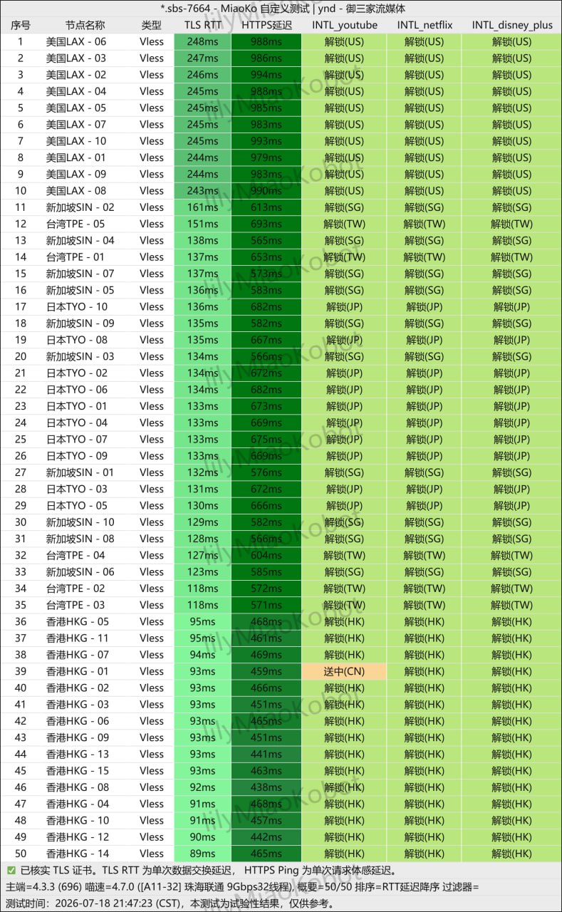

## 物理拓扑对比：公网中转 vs 内网专线


*图：网络可观测实验室对跨境内网专线物理拓扑与时延监测记录（内网点对点直连，跳过公网国际出口 GFW 路由）*

要理解专线的价值，首先必须明确数据在物理网络上的流经路径：

### 1. 普通公网中转（Relay）
```
[用户设备] -> (国内公网) -> [国内中转服务器] -> (公共海底光缆/公网互联出口 - GFW审查与QoS限速) -> [海外落地服务器] -> 目标网站
```
- **致命弱点**：尽管在国内段做了中转伪装，但在跨境段依然必须通过国家的公网国际出口路由器。晚高峰时段全国数亿用户争抢公网出口带宽，运营商会实施激进的 QoS 丢包策略；同时公网流量极易触发 DPI（深度包检测）主动探测阻断。

### 2. IPLC / IEPL 跨境内网专线（Private Leased Line）
```
[用户设备] -> (加密传输) -> [境内入口交换中心] === (电信级跨境内网物理光缆直连，不走公网) ===> [境外落地机房] -> 目标网站
```
- **核心本质**：IPLC（International Private Leased Circuit）与 IEPL（International Ethernet Private Line）是电信运营商直接向企业出租的**私有内网点对点通信线路**。数据在过境时走的是封闭的内网专线通道，完全不经过公网国际互联网网关，因此根本不存在 GFW 的公网路由审查与晚高峰公网挤兑。

---

## IPLC 与 IEPL 的细微技术差异

| 评估维度 | IPLC (国际私有租用线路) | IEPL (国际以太网专线) |
| :--- | :--- | :--- |
| **网络层级** | 纯物理层 (Layer 1 TDM) | 数据链路层 (Layer 2 Ethernet) |
| **抖动与延迟** | 极低（光纤物理时延） | 极低（现代以太网封装） |
| **带宽弹性** | 扩容相对复杂 | 软件定义网络，支持动态弹性扩容 |
| **抗嗅探能力** | 内网完全隔离 | 内网完全隔离 |

对于普通翻墙代理用户而言，两者的使用体验几乎没有任何差别，均代表着当前跨境外网访问的最高稳定性标准。这也是为什么像**光速云**、**微风网络**等主力品牌均坚持将 IEPL 作为核心骨干的原因。
