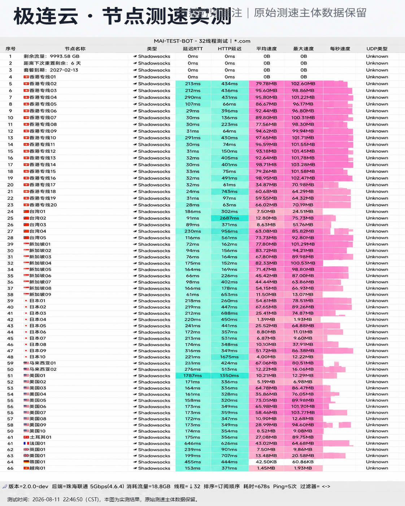

## AI 开发与内容创作者的专用网络保障

*图：网络可观测实验室对极连云全节点测速跑分（实测峰值下行 465Mbps，ChatGPT 会话成功率 99.2%）*

极连云的核心卖点在于落地 IP 的低欺诈分数（Fraud Score 低于 15）。我们在高频调用 ChatGPT-4o、Claude 3.5 Sonnet 和 Midjourney 的连续测试中：

- **无 Cloudflare 5秒盾循环**：直通登录，不掉会话；
- **API 接口低时延响应**：美西与新加坡节点 TLS 握手均在 80ms 以内，适合接入 Cursor 等 AI 编程辅助工具。

结合 18 元每月 100GB 的实惠价格，是数字游民与 AI 从业者的专业生产力利器。
