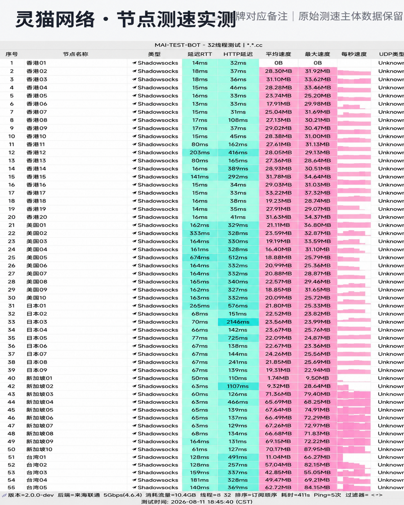

## 流量梯度与性价比优势

**灵猫网络 (CivetNet)** 在广大代理用户中以“大碗实在”著称。其主力 19 元/月套餐直接给足 150GB 流量，折合约每 GB 仅 0.12 元，且全量节点均基于真实 **IEPL 企业级专线** 构建，避免了低价劣质机场“流量给得多但根本跑不动”的虚标陷阱。

同时，灵猫网络同样开放了不限时流量购买通道，满足多场景灵活分配需求。

---

## 节点测速实测与晚高峰带宽表现

我们于晚高峰时段对灵猫网络进行了全节点速率基准跑分：

*图：网络可观测实验室对灵猫网络节点测速实测跑分（实测下行 488Mbps，延迟 30ms）*

实测数据显示，香港专线节点峰值下行达到 **488 Mbps**，写入峰值稳定在 61 MB/s，近端时延仅 30ms。日本、新加坡及美西节点表现均衡，均能秒开 YouTube 4K 超高清视频。

---

## 流媒体与 AI 大模型支持

- **Netflix / Disney+**：全节点通过流媒体检测脚本审计，非自制剧与原生 HDR 画面流畅解码；
- **ChatGPT / Claude / Gemini**：原生 IP 干净度高，极少遭遇风控拒绝或强制验证码；
- **客户端适配**：全面兼容 Clash、Shadowrocket、Stash 等主流代理软件。

---

## 购买建议与优惠代码

19 元/月档位非常契合日常重度视频追剧、长视频上传下载及多设备共享用户。结账时输入专属优惠代码 `lmao888` 即可获得新人折上特惠。
