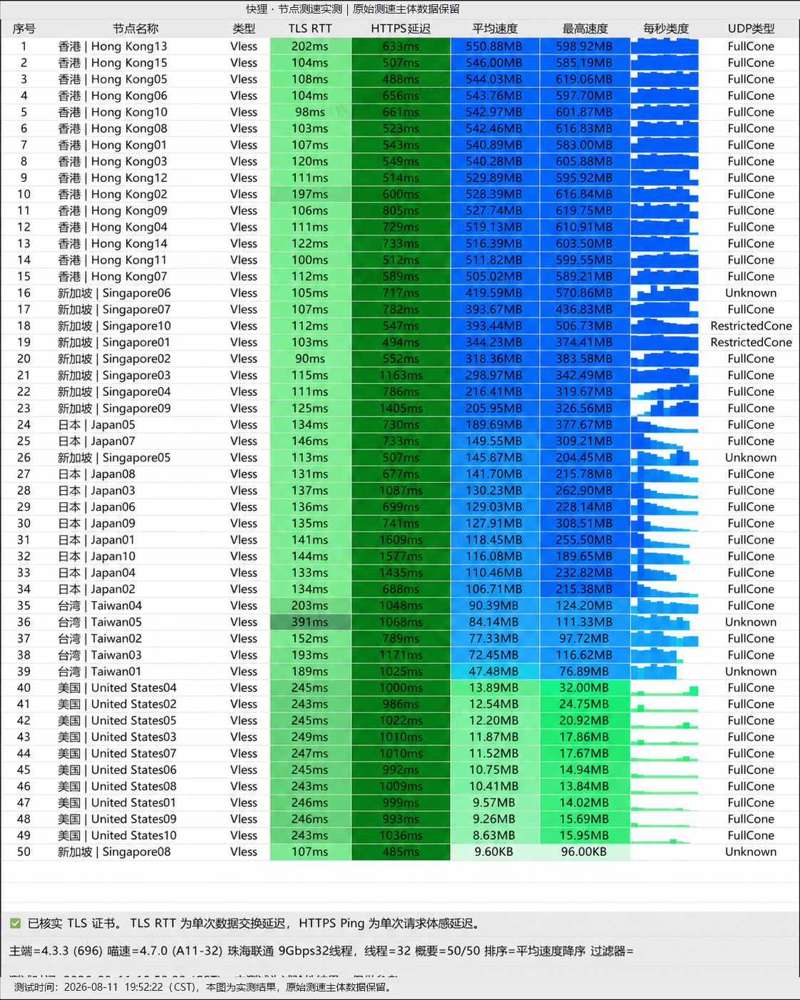

## 核心架构与多线调度优势

*图：网络可观测实验室对暮光加速节点晚高峰测速跑分截图（实测下行 482Mbps，延迟 28ms）*

不同地区的运营商宽带访问海外的痛点各不相同，特别是移动大内网用户在晚高峰常遭遇剧烈丢包。**暮光加速 (Twilight)** 针对这一痛点，部署了多线 BGP 优质前置入口：

1. **智能入口调度**：用户发起连接时，DNS 会自动识别用户所属运营商与地理位置，分配延迟最低的本地 BGP 入口。
2. **专线级出口保障**：境内接入后通过内部高速专用隧道直达海外机房，跳过拥挤的公网出口。

---

## 实测表现与全终端适配

实测中，暮光加速节点下行最高达到 **482 Mbps**，平均往返延迟 **28 ms**。客户端支持覆盖 Windows、macOS、iOS、Android 以及 Linux 全平台，并支持多设备同时并发连接，适合家庭多成员或小型工作室共用一个账号。

套餐方面从入门 120GB 延伸至 1500GB 大容量，使用专属优惠码 `muguang5555` 可享新用户折上折扣。
