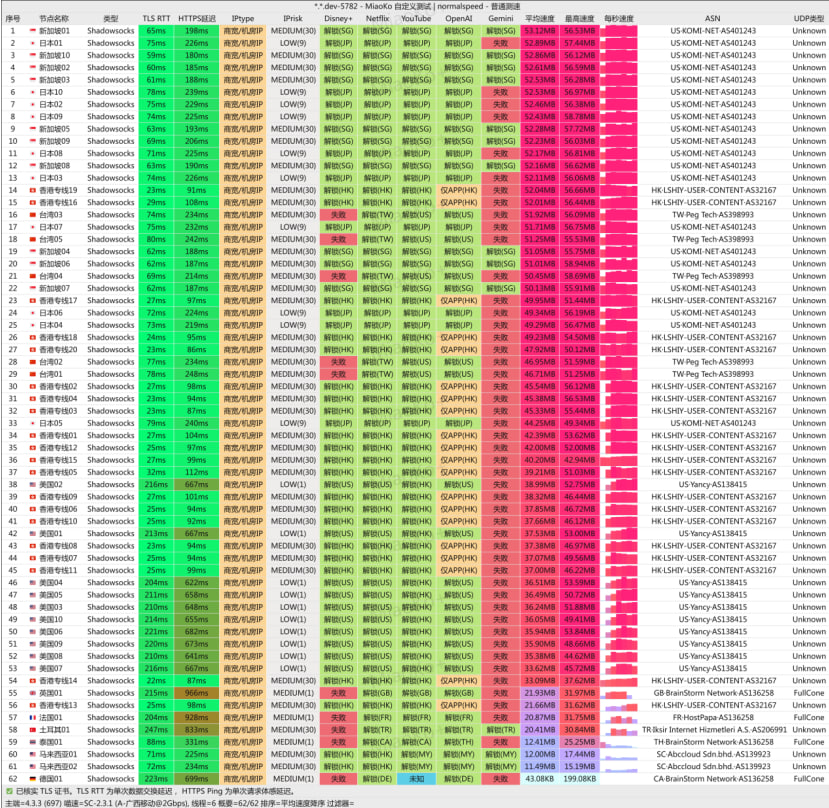

## 为什么有些节点只能看自制剧？

*图：网络可观测实验室对海外流媒体版权全区解锁检测实测数据面板（Netflix、Disney+、YouTube 4K）*

不少用户在使用廉价机场时经常遇到一个典型现象：Netflix 可以正常打开，但搜索不到本地热门电影，页面只展示 Netflix 原创剧（Originals）。

- **技术原由**：Netflix 在全球针对原创剧开放了宽松策略；但针对各个国家/地区买断的第三方影视版权，实施了极其严格的专属机房黑名单。
- **破解之道**：唯有节点使用了**纯净原生本土住宅 IP**，或机场通过特定技术做了 DNS 流媒体解锁劫持（SNI Proxy），才能让你的请求被识别为本土真实家庭用户，解锁完整的影视版权库。
- **推荐品牌**：在我们的实测中，**光速云**、**飞猫云**、**二猫云**的专线香港与日本节点均可实现非自制剧的全绿解锁。
