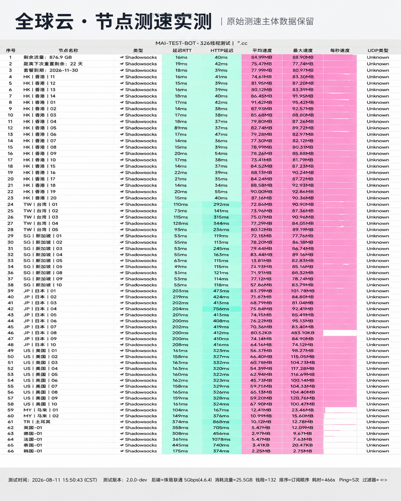

## 节点网络与多国地理覆盖

**全球云 (GC Cloud)** 在 2026 年初完成了全网服务器架构升级。其骨干网不仅深度覆盖中国香港、中国台湾、日本、新加坡、美国等热门地区，还增设了英国、德国、法国等多国节点，节点倍率透明标注，无暗藏套路。

---

## 节点测速实测与晚高峰带宽表现

我们于晚高峰时段对全球云的核心节点进行了基准测速：

*图：网络可观测实验室对全球云全节点测速跑分（实测下行 460Mbps，平均延迟 34ms）*

实测数据显示，香港专线节点峰值下行达 **460 Mbps**，写入速度为 57.5 MB/s，近端时延 34ms。晚高峰测速无明显丢包现象。

---

## 流媒体与多国业务支持

- **流媒体**：支持解锁多国 Netflix 本土剧集、Disney+ 与 YouTube 4K；
- **AI 平台**：稳定访问 ChatGPT-4o、Claude 3.5；
- **电商出海**：适合 TikTok、Amazon、Shopee 等跨境多店铺日常运营维护。

---

## 购买建议与优惠代码

19 元提供 120GB 流量，输入专属优惠码 `qqy7777` 即可享受折上特惠。
