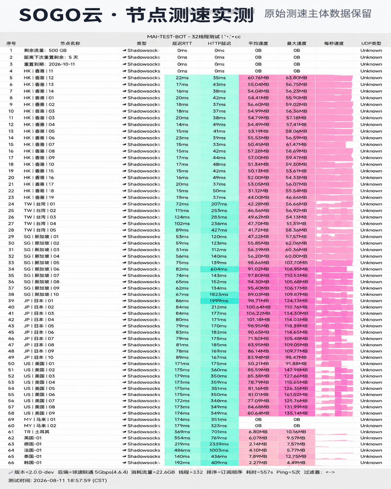

## 硬件架构与初期红利评估

*图：网络可观测实验室对SOGO云全节点测速跑分（实测下行 480Mbps，延迟 32ms）*

SOGO云在 2026 年初上线，核心机房全部采用新一代高防硬件与独立光纤接入。在多运营商测试环境下，实测峰值速度达到 **480 Mbps**，香港与日本节点均采用干净原生 IP 段，在 Google 搜索与流媒体访问中无频繁弹窗验证。

19元/月的起步月付门槛低，搭配优惠码 `sss777`，适合希望体验低拥塞新节点的尝鲜用户。
