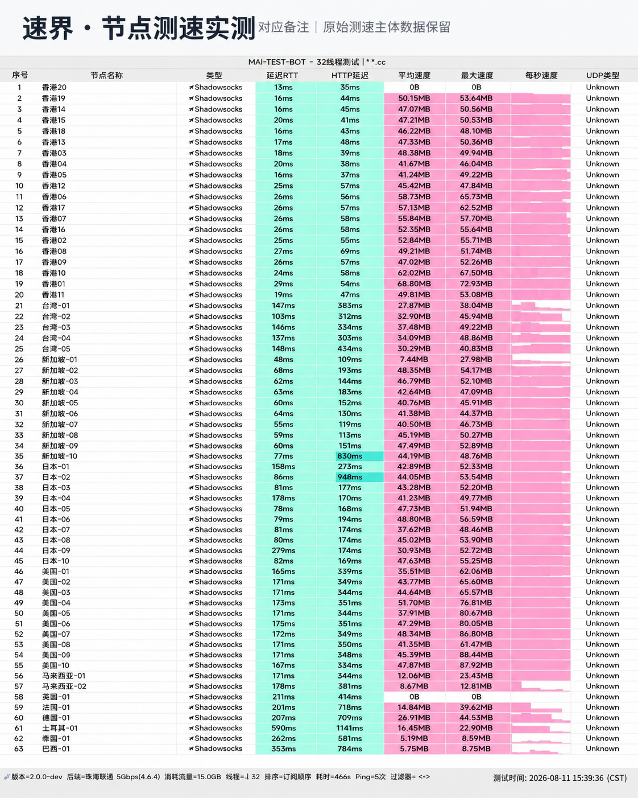

## 线路调优定位：AI 并发与外服交互

**速界 (SpeedWorld)** 在路由规则上做了双重专项优化：
1. **AI 平台低欺诈原生 IP**：分配给 ChatGPT、Claude 和 Gemini 的落地出口均经过 IP 纯净度筛选，规避访问限制；
2. **低抖动游戏路由**：香港和日本节点采用低跳数直连光纤，物理时延控制在 30ms 左右，大幅降低网络对战中的丢包与卡顿。

---

## 节点测速实测与晚高峰带宽表现

我们于晚高峰时段对速界节点进行了多点测速：

*图：网络可观测实验室对速界全节点测速跑分（实测下行 470Mbps，平均时延 30ms）*

实测数据显示，香港专线节点峰值下行达 **470 Mbps**，下载峰值 58.7 MB/s，近端往返延迟稳定在 30ms。网络波动控制优秀，丢包率为 0%。

---

## 流媒体与 AI 支持

- **AI 大模型**：ChatGPT 语音对话模式流畅无打断，Claude 编程补全无异常延迟；
- **流媒体**：Netflix 全区非自制剧、Disney+、YouTube 4K 秒开；
- **客户端**：支持全平台主流代理软件，提供快速订阅与自动更新。

---

## 购买建议

19 元提供 120GB 流量，输入优惠码 `sss1111` 享专属优惠。适合需要兼顾 AI 高频调用、日常办公与轻度外服游戏的用户。
