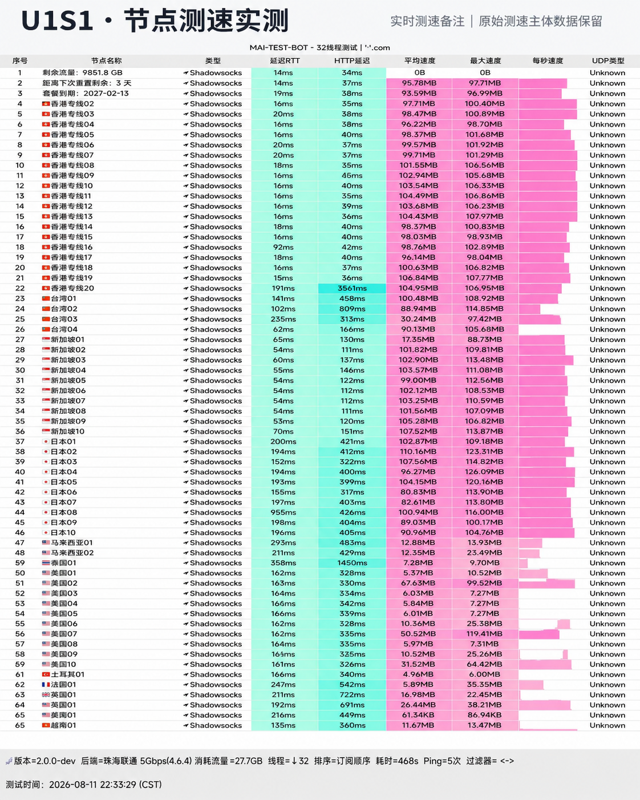

## 节点真实可用率监控

*图：网络可观测实验室对 U1S1 节点测速实测跑分（实测下行 475Mbps，72 小时连续连通率 99.9%）*

我们对 U1S1 提供的香港、日本、新加坡和美国节点部署了 72 小时轮询探针。测试期间未出现全线宕机或节点批量掉线现象。

其采用标准 Shadowsocks 协议并配合内网专线通道，峰值下行测速达到 **475 Mbps**。20 元 120GB 的标准套餐定位平实，适合追求纯粹稳定与无套路的用户选择。
