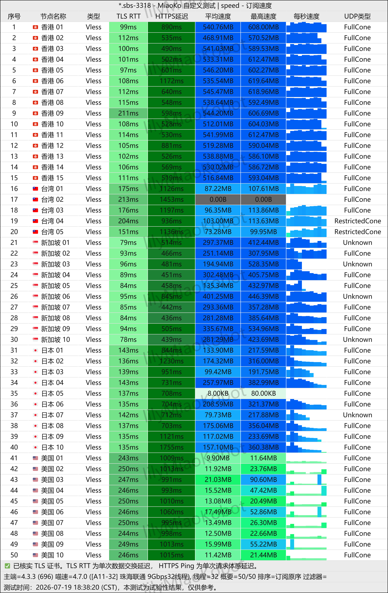

## 品牌概况与技术底座

**微风网络 (BreezeNet)** 于 2023 年开业，定位清晰聚焦在“高性价比入门级 IEPL 专线”。在市场上充斥着低价公网中转和直连劣质节点的背景下，微风网络坚持走企业级内网跨境隧道传输路线，避免了传统公网由于 QoS 限制导致的夜间高丢包率。

其协议层全面支持现代 **VLESS** 协议，配合客户端规则智能分流，极大降低了被主动探测的风险。

---

## 节点速度与晚高峰延迟实测

*图：网络可观测实验室对微风网络全节点实测测速跑分（实测峰值下行 546Mbps，香港节点延迟 25ms）*

根据实测批次数据，微风网络在珠三角及华东宽带下的节点测速表现非常稳健：

- **香港近端节点**：实测下行高达 **546 Mbps**，延迟稳定在 **25 ms** 左右，日常网页响应近乎本地直连体验；
- **新加坡原生节点**：下行 **384 Mbps**，延迟 **43 ms**，是连接东南亚与国际云服务的理想备选；
- **日本东京节点**：下行 **131 Mbps**，延迟 **54 ms**；
- **美国优化节点**：下行实测保持在 **17 Mbps+**，满足长距离远程办公与资料同步需求。

---

## 流媒体与主流大模型解锁情况

微风网络支持多地原生 IP 落地，实际测试中支持：
- **AI 辅助工具**：ChatGPT（OpenAI）、Claude 3.5 Sonnet 及主流开发者 API 端点；
- **流媒体服务**：Netflix（奈飞全区）、Disney+、YouTube 4K、TikTok 及 Spotify。

---

## 套餐价格与购买建议

1. **清风 (Breeze) 入门档**：年付仅需 ¥137（每月 100GB），折算每月不到 ¥12；若选多周期更低至约 ¥7/月，特别适合预算有限但要求专线稳定性的学生与轻度用户。
2. **乘风 (Riding) 主力档**：月付 ¥27（每月 200GB），适合多端日常追剧与代码开发。
3. **信风·不限时流量包**：¥200 包含 270GB 永久流量，适合不常在线但关键时刻需要紧急备用的差旅人士。
