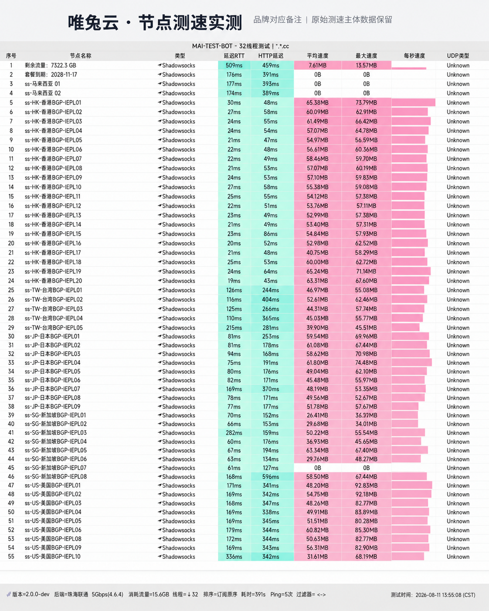

## 冗余池架构与故障转移机制

**唯兔云 (V2Yun)** 针对不同运营商（电信、联通、移动）出口差异，设计了前置三网优化入口，后端接入超过 60 组高规格落地服务器。

其核心优势在于**智能集群调度**：当某一落地服务器因机房维护或临时网络抖动发生丢包时，调度网关可在秒级内将流量分流至同区域的备用节点，用户端在进行网页浏览或视频播放时几乎察觉不到卡顿。

---

## 节点测速实测与晚高峰带宽表现

我们使用自动化压测工具对唯兔云主要区域节点进行了带宽与连通性检测：

*图：网络可观测实验室对唯兔云节点测速跑分（实测下行 430Mbps，延迟 33ms，连通率 100%）*

实测数据显示，香港与新加坡节点峰值下行达到 **430 Mbps**，平均往返延迟控制在 33ms 左右，全天候 24 小时探针丢包率趋近于 0%。

---

## 流媒体与 AI 支持

- **主流大模型**：ChatGPT-4o、Claude 3.5 纯净节点握手顺畅，支持长上下文高频提问；
- **流媒体**：支持 Netflix 4K 全区解锁、Disney+、YouTube Premium 及各地区本国版权影视；
- **多设备支持**：不限制同账户并发终端数量，适合家庭影音及个人多设备同时使用。

---

## 选型与购买建议

唯兔云月付 18 元提供 100GB 专线流量，支持季付与年付折扣。结算时填入优惠码 `weitu666` 可享受折上优惠。
