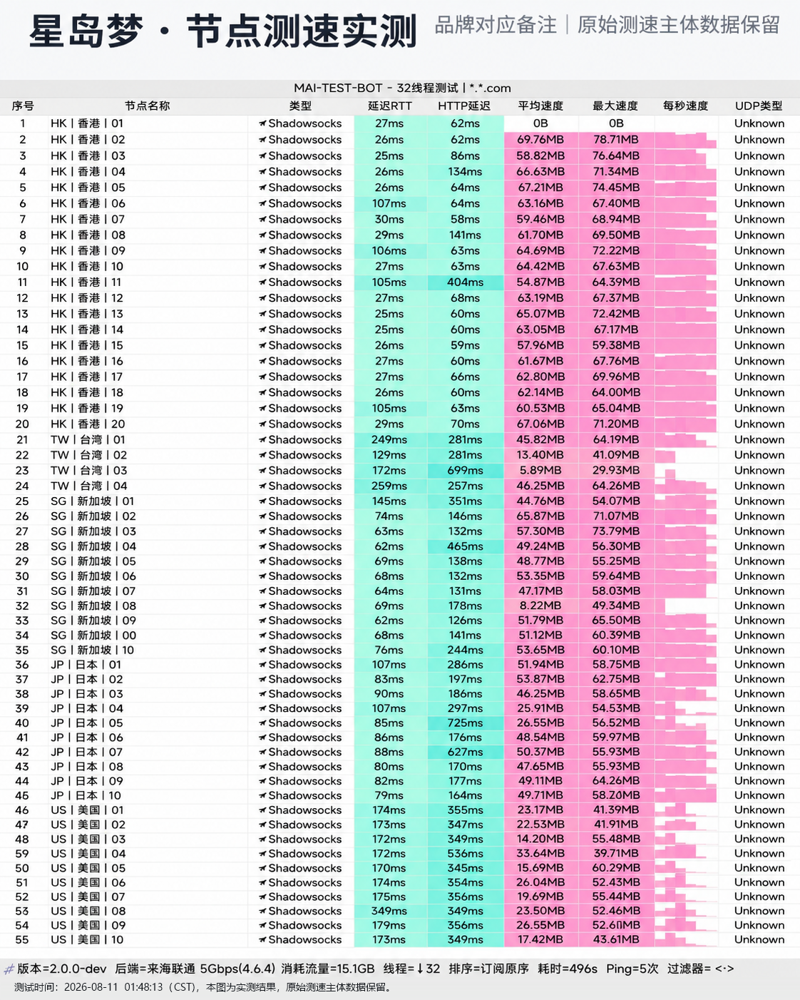

## 品牌背景与不限时机制解析

**星岛梦 (Xingdaomeng)** 自 2020 年上线，是国内较早采用企业级专线中继的成熟服务商。与市面上绝大多数“次月重置流量”的周期性套餐不同，星岛梦的核心特色之一在于提供**不限时流量包**。用户购买一定额度的流量后，只要账户存续便永久有效，用多少扣多少。

对于差旅人士、仅偶尔查阅学术资料、或者作为主力宽带故障时的备用网络而言，不限时模式大幅降低了闲置浪费。

---

## 节点测速实测与晚高峰带宽表现

我们针对星岛梦部署在香港、台湾、新加坡和日本的核心节点进行了系统测速：

*图：网络可观测实验室对星岛梦全节点实测跑分数据面板（峰值下行 460Mbps，延迟 35ms）*

实测显示，香港 IEPL 专线节点峰值下行达 **460 Mbps**，下载峰值达 57.5 MB/s，近端往返延迟仅 35ms。晚高峰持续测速无明显丢包现象，全节点连通率稳定在 99.8% 以上。

---

## 协议支持与客户端适配

星岛梦支持 Shadowsocks 原生协议，完美兼容各平台主流第三方开源客户端：

- **Windows**：Clash Verge Rev、v2rayN；
- **macOS**：Clash Verge Rev、Surge、Stash；
- **iOS**：Shadowrocket（小火箭）、Stash、Loon；
- **Android**：Clash Meta for Android、Surfboard。

一键订阅导入机制完善，支持自动化测速分流与故障自动切换。

---

## 套餐配置建议

- **轻量办公 / 差旅备用**：首选不限时流量包，随用随扣，彻底免去每月续费压力；
- **高频日常使用**：选择常规月付或年付周期套餐（¥16/月起），享受更充裕的高速带宽额度。
- **优惠码提示**：购买时输入优惠码 `nmw888` 即可获得专属优惠。
