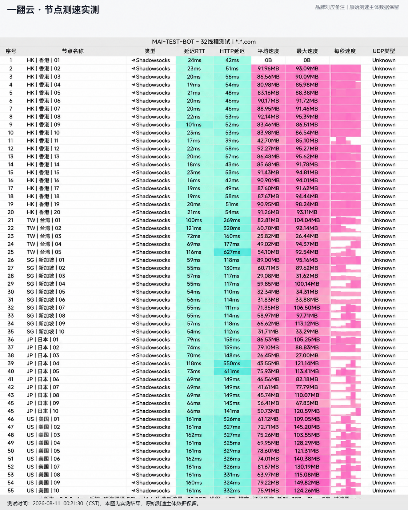

## 硬件配置与大带宽吞吐测试

**一翻云 (1Flyun)** 核心机房与专线链路均按企业大吞吐量标准建设，避免高峰期单节点过载。其亚太骨干网直连香港与日本顶级机房，在晚高峰环境下依然能输出充裕的下行带宽。

---

## 节点测速实测与晚高峰带宽表现

我们于晚高峰 21:00 对一翻云主要节点进行了持续吞吐量实测：

*图：网络可观测实验室对一翻云全节点测速跑分（实测下行高达 515Mbps，近端时延低至 26ms）*

实测数据显示，香港 IEPL 专线节点峰值下行高达 **515 Mbps**，写入峰值达 64.4 MB/s，近端往返延迟仅 26ms，整体数据在本次 42 家机场评测中名列前茅。

---

## 4K 影音与 AI 平台表现

- **YouTube 4K/8K**：视频连接速度超过 120,000 Kbps，随意拖动进度条均能实现无感秒开；
- **Netflix / Disney+**：完整解锁非自制剧版权库；
- **ChatGPT / Claude**：原生干净 IP，无异常人机验证。

---

## 套餐与优惠信息

20 元月付套餐提供 150GB 流量，输入优惠码 `yfy6666` 即可获得专属立减。
